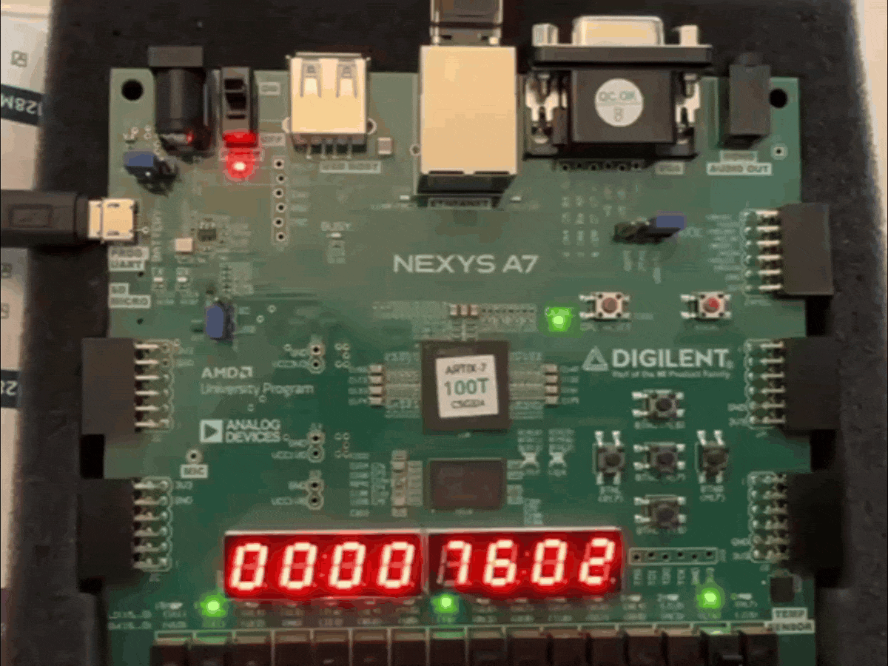
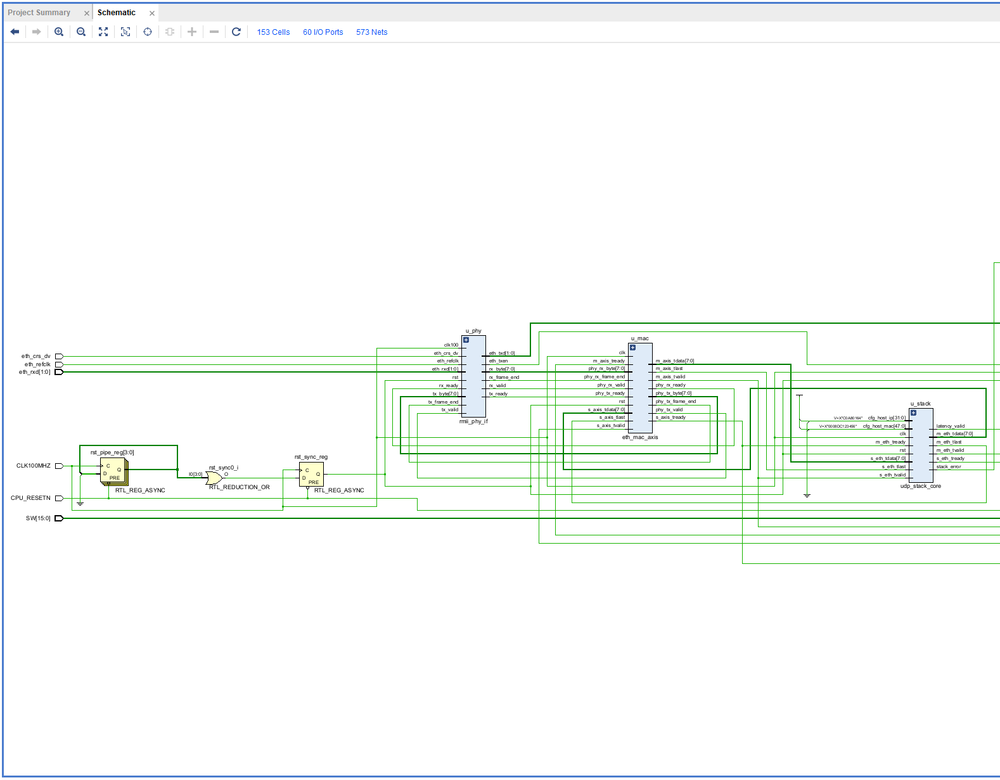
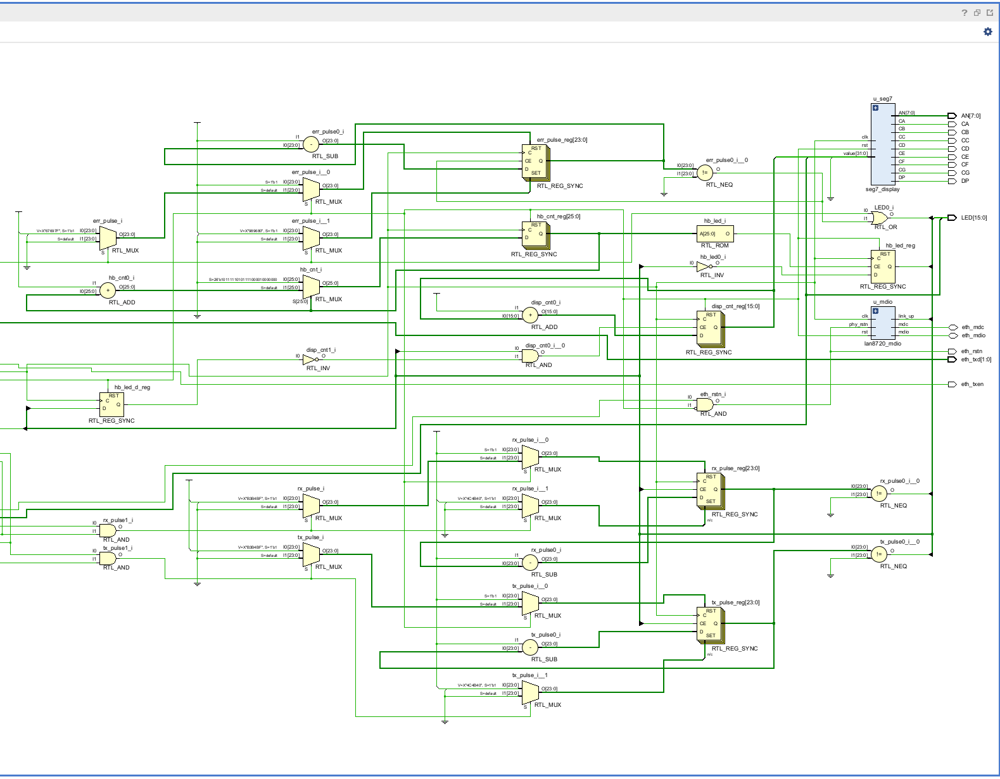
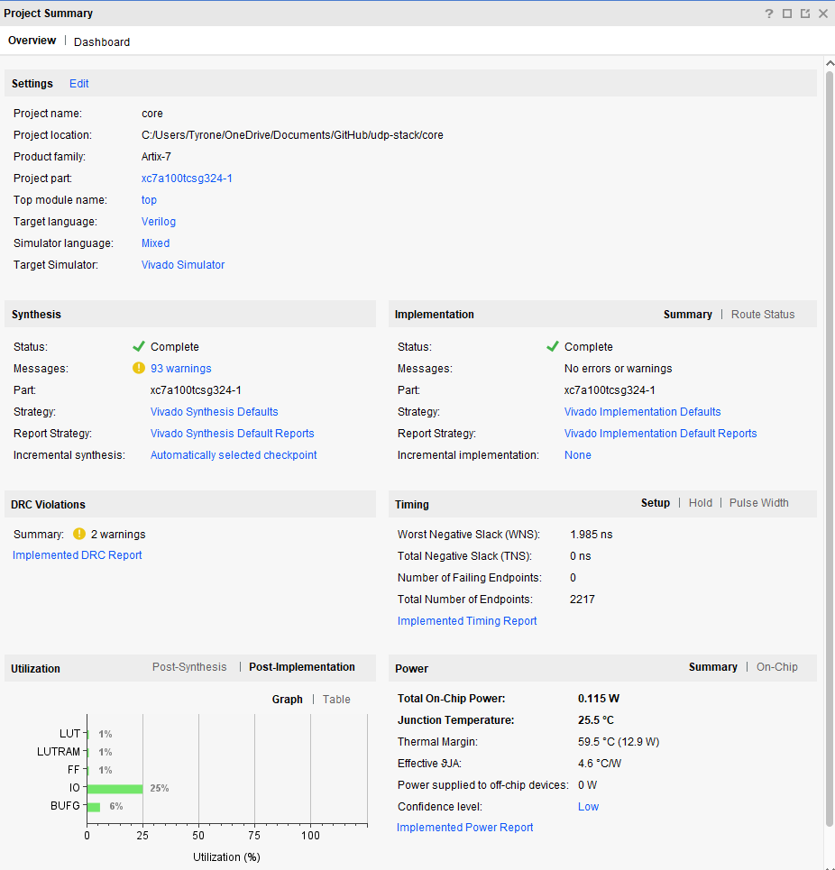
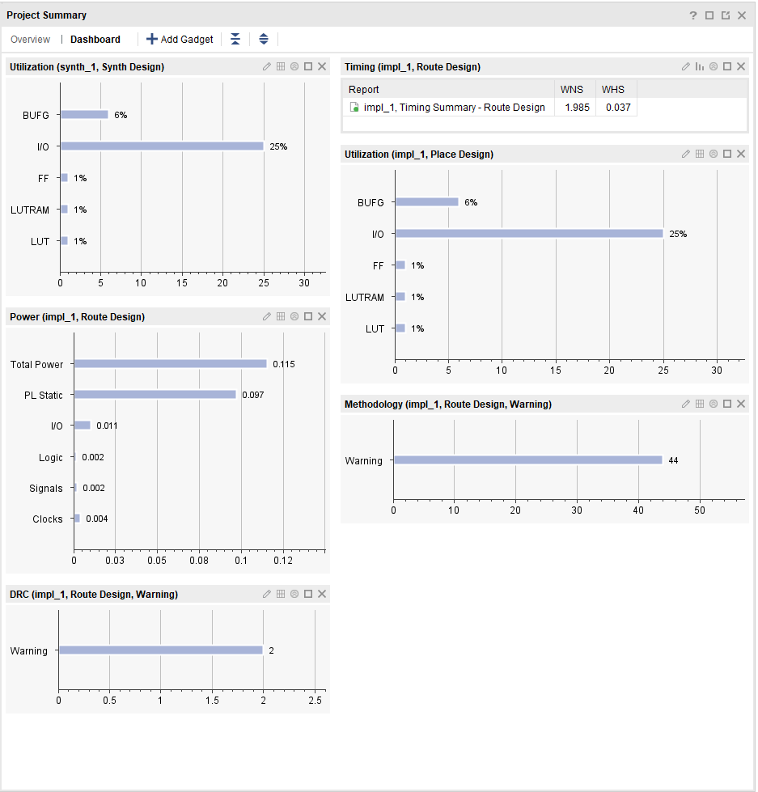
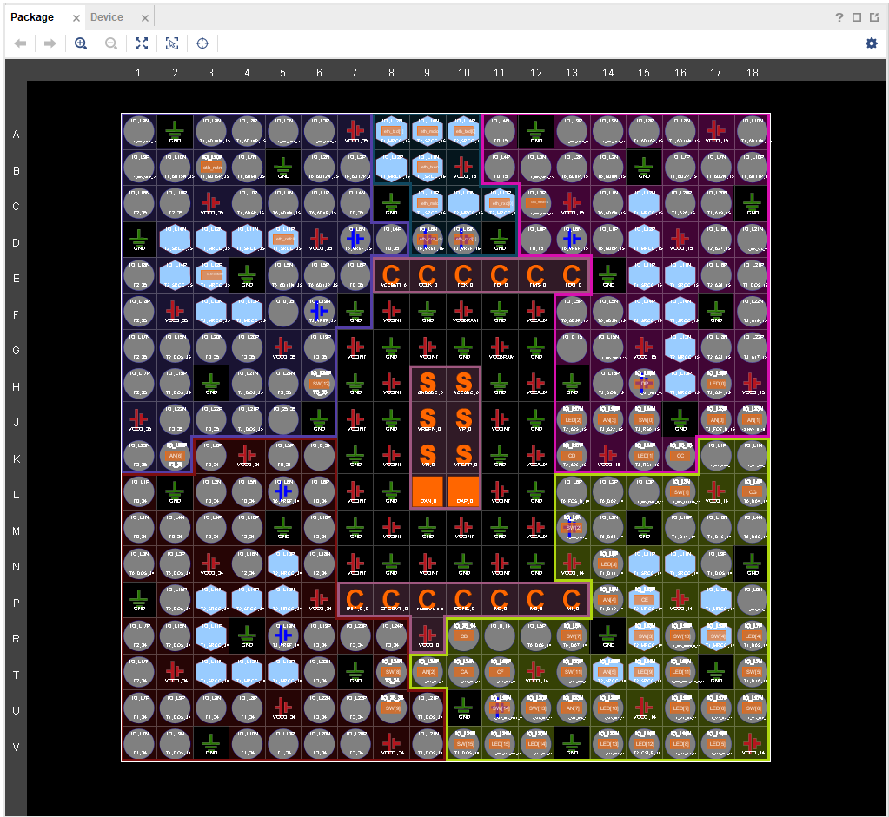
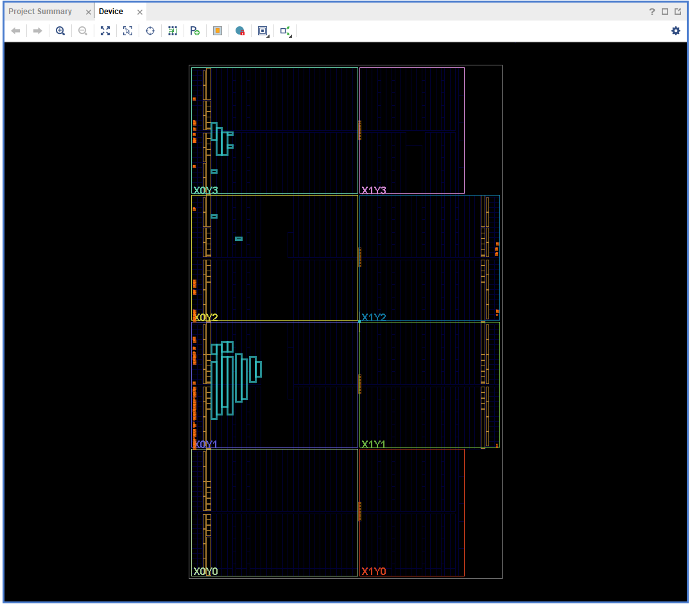
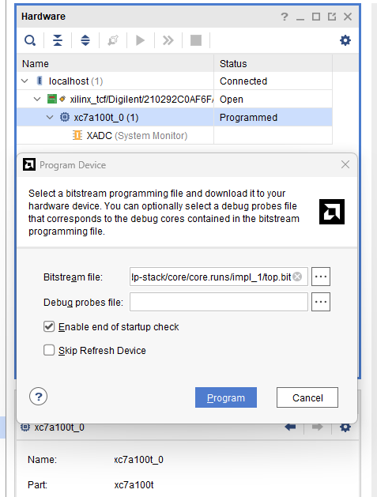

# 100 Mbps UDP/IP Stack (Nexys A7)


SystemVerilog · cocotb · Python · Vivado · [github.com/tmarhguy/udp-stack](https://github.com/tmarhguy/udp-stack)

**See also:** [Understanding the UDP Stack and Connecting to ITCH](https://www.tmarhguy.com/writing/2026-08-08-understanding-udp-stack-and-connecting-to-itch/) · [ITCH Ethernet lab bring-up](https://www.tmarhguy.com/writing/2026-08-01-itch-ethernet-lab-bring-up/) · [ITCH synthesis / bitstream](https://www.tmarhguy.com/writing/2026-08-02-successful-synthesis-implementation-bitstream/) · [NASDAQ ITCH Hardware Parser](https://github.com/tmarhguy/itch-hw)

---

### Why this exists

In conversations with business friends — especially Wharton students — NASDAQ comes up a lot. The argument usually starts with the **open book**: visible bids and asks, buy low, sell high, move fast. [itch](https://github.com/tmarhguy/itch) is where I put the parser and order book in silicon. But ITCH rides on **UDP**, and UDP rides on **Ethernet** — and none of that exists by default on an FPGA.

**`TCP`** is not your friend if speed is your goal. Three-way handshake, retransmits, kernel buffers — all fine for a file download, all wrong when the only frame that matters is the **latest** one on the wire. **`UDP`** multicast is how exchanges push market data: fire the newest update, drop anything stale, keep moving.

This repo is the **networking column** — RMII PHY, MAC, IPv4, UDP, cut-through echo — so [itch](https://github.com/tmarhguy/itch) can worry about messages instead of wondering how bytes got off the cable. Fifteen SystemVerilog files. No soft CPU. No OS in the hot path.

The [design journal](log/) is where the TCP-vs-UDP argument lives; the [Aug 08 essay](https://www.tmarhguy.com/writing/2026-08-08-understanding-udp-stack-and-connecting-to-itch/) is the public version. This README is the map.

<p align="center">
  
</p>

<p align="center"><em>Nexys A7-100T · Artix-7 · Ethernet in, heartbeat on the 7-segment, link LED lit — the stack is running on silicon</em></p>

---

## Contents

- [At a glance](#at-a-glance)
- [What this repo does](#what-this-repo-does)
- [The loop](#the-loop)
- [Architecture at a glance](#architecture-at-a-glance)
- [Repository map](#repository-map)
- [Platform](#platform)
- [Build status](#build-status)
- [Run it](#run-it)
- [Docs & notes](#docs--notes)
- [Project status](#project-status)
- [Author](#author)

---

### At a glance

*Last Vivado build: 2026-08-10 · Vivado 2025.2*

| | |
|---|---|
| **Timing** | **Met** @ 100 MHz — WNS **+1.985 ns**, WHS **+0.037 ns**, 0 failed endpoints |
| **Fabric** | LUT **1.19%** · FF **0.47%** · IO **24.8%** · BUFG **6.25%** · power **0.115 W** |
| **Sim latency** | UDP payload echo **2 cy** (20 ns) on `loopback_echo` @ 100 MHz |
| **Bitstream** | `core/core.runs/impl_1/top.bit` · Vivado **2025.2** |

Details: [docs/metrics.md](docs/metrics.md) · Vivado GUI walkthrough: [core/README.md](core/README.md)

---

## What this repo does

NASDAQ's Mold-wrapped ITCH feed rides on **UDP**. Before any parser sees a byte, the FPGA needs to:

- Bring up the **LAN8720** PHY over RMII (50 MHz ref + 100 MHz system)
- Strip preamble/FCS in the **MAC**, demux **IPv4** from Ethernet
- Parse **IP** and **UDP** headers, filter destination port **50000**
- **Echo** the payload cut-through and rebuild headers with swapped src/dst

Today the proof point is a **UDP echo**: send a datagram from the host, get it back on silicon with deterministic latency. Tomorrow the same MAC → IP → UDP spine plugs into [itch](https://github.com/tmarhguy/itch)'s Mold unwrap — same RJ45, different payload handler.

Simulation comes first: cocotb replays synthetic Ethernet frames against the stack core. **2-cycle** loopback latency before the bitstream gets trusted.

<p align="center">
  
  
</p>

<p align="center"><em>Left: board I/O + PHY/MAC · Right: <code>u_stack</code>, 7-segment, RMII egress</em></p>

---

## The loop

Every lab session runs the same story. Here the whole arc lives on one FPGA — no host in the hot path.

```
  HOST IN              STACK                 HOST OUT
  ───────              ─────                 ────────
  UDP datagram    →    RMII RX → MAC    →    UDP reply
  port 50000           IP → UDP → echo       (swapped hdrs)
```

**1. Wire in.** Live traffic hits the on-board **LAN8720** PHY. RMII RX, IPv4 filter, UDP port match — payload bytes reach `loopback_echo` without a CPU `memcpy`.

**2. Echo.** Cut-through forwarding rebuilds Ethernet + IPv4 + UDP headers with swapped addresses. Latency instrumentation reports cycle count on **LED[12]**.

**3. Wire out.** Reply leaves through the same MAC and PHY. **LED[9]** / **LED[10]** pulse on RX/TX activity; **LED[13]** / **LED[15]** show link up. The 7-segment display and switch-mirrored LEDs tell you the bitstream is alive before you ever send a packet.

---

## Architecture at a glance

### Datapath

```
RMII PHY ──► eth_mac_axis ──► eth_demux ──► ip_rx ──► udp_rx ──► loopback_echo
                                                                    │
                                                              stack_tx ◄──┘
                                                                    │
                                                         eth_mac_axis ──► RMII PHY
```

Board top: [`core/rtl/top.sv`](core/rtl/top.sv)  
Stack core: [`core/rtl/stack/udp_stack_core.sv`](core/rtl/stack/udp_stack_core.sv)

### Layer modules

| Layer | Module | Role |
|-------|--------|------|
| PHY | `rmii_phy_if`, `lan8720_mdio` | RMII byte stream, MDIO link status |
| L2 | `eth_mac_axis` | Preamble/FCS strip, CRC on TX |
| L2 demux | `eth_demux` | IPv4 forward; ARP detect (lab: pre-seed host MAC) |
| L3 | `ip_rx` | IPv4 header parse, dst-IP filter |
| L4 | `udp_rx` | UDP header parse, dst-port filter (`50000`) |
| App | `loopback_echo` | Cut-through payload echo + latency counter |
| TX | `stack_tx` | Rebuild Ethernet / IPv4 / UDP headers |

### Clocks

| Clock | Source | Period |
|-------|--------|--------|
| `CLK100MHZ` | Board oscillator | 10 ns (100 MHz) |
| `eth_refclk` | PHY RMII ref | 20 ns (50 MHz) |

Async clock groups in [`core/constrs/nexys_a7_100t.xdc`](core/constrs/nexys_a7_100t.xdc) — required for the RMII CDC FIFO.

### Lab defaults

| Parameter | Value |
|-----------|-------|
| FPGA IP | `192.168.1.10` |
| Host IP | `192.168.1.100` |
| Host MAC | `00:08:DC:12:34:56` (edit in `core/rtl/top.sv`) |
| UDP port | `50000` |
| Part | `xc7a100tcsg324-1` |

Broadcast (`255.255.255.255`) works for direct-cable tests without ARP.

---

## Repository map

```
udp-stack/
├── core/
│   ├── rtl/                  # 15 SystemVerilog sources (design truth)
│   ├── constrs/              # Pin + clock constraints
│   ├── core.xpr              # Vivado project
│   └── README.md             # GUI setup walkthrough
├── sim/                      # cocotb + testbenches
├── docs/                     # [Documentation index](docs/README.md)
├── log/                      # Design journal — [index](log/README.md)
├── media/                    # Bench photos, Vivado screenshots
└── tools/                    # send_udp.py, bench_check.py
```

---

## Platform

| | |
|---|---|
| **Board** | Digilent Nexys A7-100T |
| **FPGA** | Xilinx Artix-7 `xc7a100tcsg324-1` · 100 MHz system clock |
| **Toolchain** | Xilinx **Vivado** 2025.2 (synthesis, place & route, bitstream) |
| **Ethernet** | SMSC LAN8720A · RMII · lab UDP port **50000** |
| **Simulation** | cocotb + Icarus Verilog (CI on Ubuntu) |

---

## Build status

First clean Vivado run (**2026-08-10**): synthesis, implementation, and bitstream passed — **timing closed** at 100 MHz. Light on fabric, heavy on I/O — exactly what a wire-facing stack should look like.

<p align="center">
  
  
</p>

<p align="center"><em>Left: project summary · Right: utilization and timing dashboard (<code>synth_1</code> / <code>impl_1</code>)</em></p>

| Resource | Used | Util% |
| -------- | ---- | ----- |
| LUT | 756 | 1.19% |
| FF | 599 | 0.47% |
| IO | 52 | 24.76% |
| BUFG | 2 | 6.25% |
| Power (est.) | — | 0.115 W |

*From `core/core.runs/impl_1/` reports · screenshots in `media/`*

<p align="center">
  
  
</p>

<p align="center"><em>Left: package pinout (<code>eth_rxd</code>, <code>eth_txd</code>, <code>eth_mdc</code>, …) · Right: placed design on silicon</em></p>

Program the board and the JTAG target shows up ready to go:

<p align="center">
  
</p>

<p align="center"><em>Hardware Manager — <code>top.bit</code> loaded, <code>xc7a100t_0</code> on the bench</em></p>

---

## Run it

**Simulate** (stack loopback, no PHY):

```text
cd sim/cocotb
pip install -r ../requirements.txt
python run_tests.py
```

**Unit tests** (UDP, IP, ARP cache, MAC):

```text
cd sim/cocotb
TEST=udp python run_tests.py
TEST=ip  python run_tests.py
TEST=arp python run_tests.py
TEST=mac python run_tests.py
```

**Build in Vivado** (GUI): see [core/README.md](core/README.md) — add `core/rtl/` as Design Sources, set top to `top`, add `core/constrs/nexys_a7_100t.xdc`.

**Program & test** on the bench:

```text
python tools/send_udp.py --host 255.255.255.255 --port 50000
```

Or targeted:

```text
python tools/bench_check.py
```

Full bench notes: [docs/board_setup.md](docs/board_setup.md)

### LEDs (after programming)

| LED | Meaning |
|-----|---------|
| `[7:0]` | Mirror `SW[7:0]` |
| `[8]`, `[14]` | Heartbeat (~1 Hz) |
| `[9]` | RX activity pulse |
| `[10]` | TX activity pulse |
| `[11]` | Stack error |
| `[12]` | Latency valid (pulse) |
| `[13]`, `[15]` | PHY link up |

7-segment: right 2 digits = `SW[7:0]` hex; next 2 = heartbeat counter.

---

## Docs & notes

| Doc | What's in it |
|---|---|
| [docs/README.md](docs/README.md) | Documentation index |
| [docs/architecture.md](docs/architecture.md) | Data path, module hierarchy, clocks |
| [docs/board_setup.md](docs/board_setup.md) | Cable, LEDs, host IP, traffic |
| [docs/metrics.md](docs/metrics.md) | Timing, utilization, latency — sourced from reports |
| [core/README.md](core/README.md) | Vivado GUI project setup |
| [log/](log/) | Design journal |

### Design journal

| Log | Topic |
|-----|-------|
| [2026-08-08 — Understanding UDP & ITCH](log/2026-08-08%20-%20Understanding%20the%20UDP%20stack%20and%20connecting%20to%20ITCH.md) | Why UDP, link to itch |

### Writing (tmarhguy.com)

| Essay | Topic |
|-------|-------|
| [Understanding the UDP Stack and Connecting to ITCH](https://www.tmarhguy.com/writing/2026-08-08-understanding-udp-stack-and-connecting-to-itch/) | TCP vs UDP for market data |
| [ITCH Ethernet lab bring-up](https://www.tmarhguy.com/writing/2026-08-01-itch-ethernet-lab-bring-up/) | Cable, link LED, end-to-end goal |
| [ITCH synthesis / bitstream](https://www.tmarhguy.com/writing/2026-08-02-successful-synthesis-implementation-bitstream/) | itch first clean Vivado run (Aug 02) |

---

## Project status

**As of August 2026**

| Area | Status | Notes |
|------|--------|-------|
| RMII PHY + MDIO | **Working** | Link LED, 50/100 MHz CDC |
| MAC (RX/TX) | **Working** | Preamble strip, FCS on TX |
| IPv4 + UDP RX | **Working** | Port filter, header parse |
| Cut-through echo | **Working** | 2-cycle payload latency in sim |
| ARP | **Lab stub** | Pre-seed host MAC; `arp_cache` single-entry |
| Vivado bitstream | **Clean** | WNS +1.985 ns @ 100 MHz |
| itch integration | **Next** | Replace echo with Mold/ITCH ingress ([itch](https://github.com/tmarhguy/itch)) |

**Direction:** Prove the wire path here, then hand the parsed byte stream to [itch](https://github.com/tmarhguy/itch) for order-book logic. Same board, same PHY — different payload handler above UDP.

---

## Author

**Tyrone Marhguy** — Computer Engineering '28, [University of Pennsylvania](https://www.upenn.edu/)

Personal FPGA project: custom UDP/IP on Nexys A7, companion stack for hardware ITCH parsing, and a public build log. Questions or collabs — reach out.

<p align="center">
  <a href="mailto:tmarhguy@gmail.com"></a>
  <a href="https://twitter.com/marhguy_tyrone"></a>
  <a href="https://instagram.com/tmarhguy"></a>
  <a href="https://substack.com/@tmarhguy"></a>
  <a href="https://github.com/tmarhguy"></a>
</p>

<p align="center">
  
  
  
  
</p>
